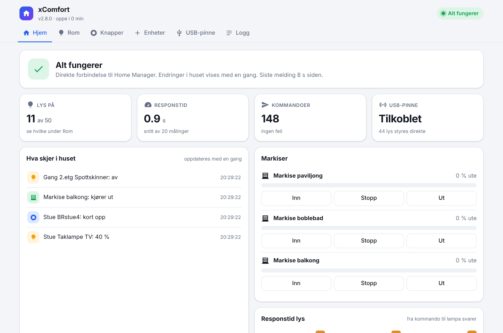
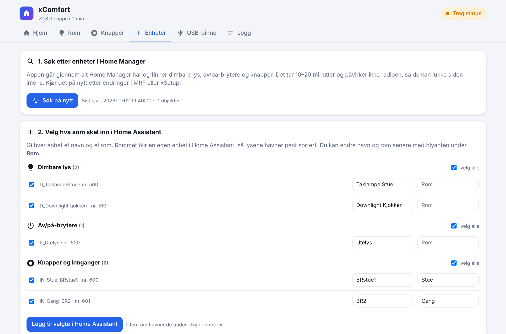
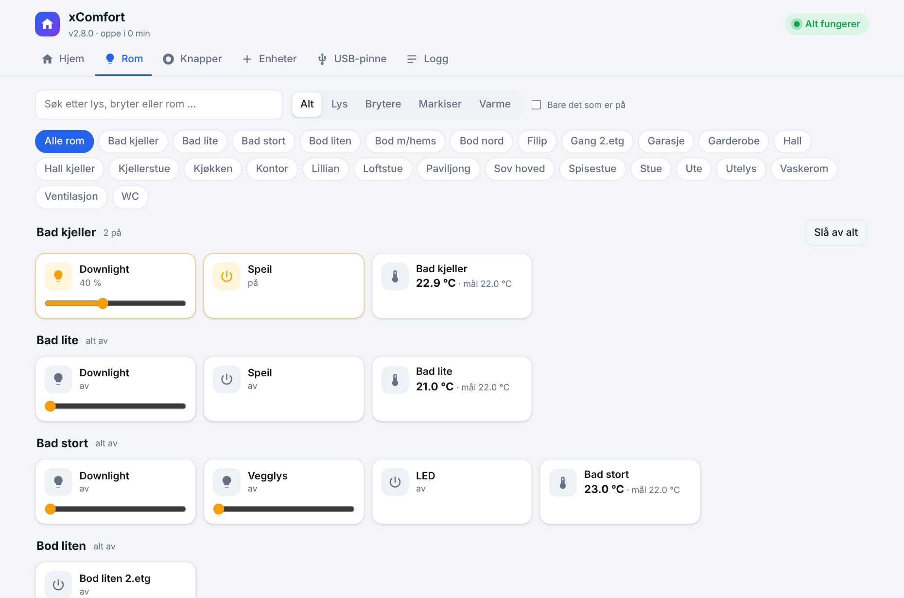
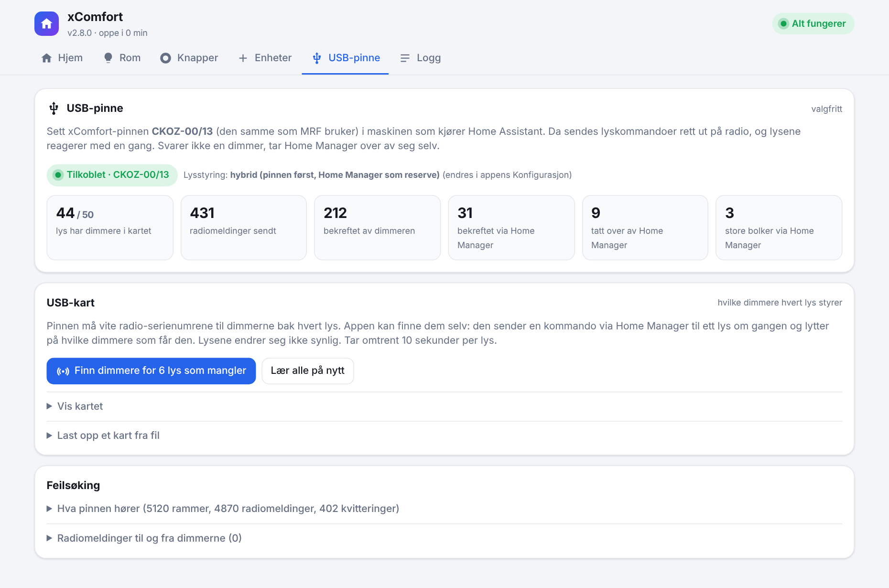
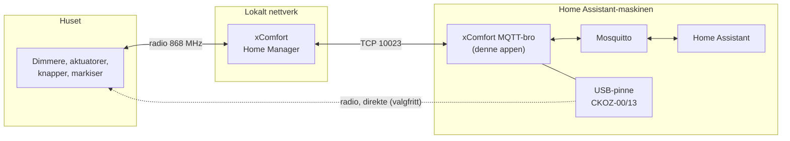

<p align="center">
  
</p>

<h3 align="center">Eaton / Sensio xComfort i Home Assistant. Helt lokalt.</h3>

<p align="center">
  Ingen sky. Ingen app. Ingen ventetid.<br>
  Lys, brytere, markiser, termostater, sensorer og veggknapper rett inn i Home Assistant,<br>
  med en valgfri USB-pinne som styrer lysene direkte over radio.
</p>

<p align="center">
  <a href="https://my.home-assistant.io/redirect/supervisor_add_addon_repository/?repository_url=https%3A%2F%2Fgithub.com%2FPolsaFH%2Fxcomfort-ha"></a>
</p>

<p align="center">
  
  
  
  
</p>

<p align="center">
  <picture>
    <source media="(prefers-color-scheme: dark)" srcset="bilder/hjem-mork.png">
    
  </picture>
</p>

> [!WARNING]
> **Tidlig versjon.** Appen er laget på og testet grundig i ett hus med ca. 100 xComfort-enheter.
> Nå åpnes den for flere. Den gjør ingenting med anlegget ditt før du selv velger hva som skal inn,
> men ta en sikkerhetskopi av Home Assistant først, og si gjerne fra under
> [Issues](https://github.com/PolsaFH/xcomfort-ha/issues) hvis noe ikke virker.

<details>
<summary><b>🇬🇧 English summary</b></summary>

A Home Assistant app (add-on) that connects an **Eaton / Sensio xComfort Home Manager** (the controller
used with the eoptHome app) to Home Assistant, **fully locally** over the same TCP protocol the official
app uses (port 10023). No cloud, no app, no internet.

- Lights, switches and wall buttons are discovered from the Home Manager and added from a built-in web page.
- Changes made with wall switches show up in Home Assistant in under a second.
- Optional: plug in the **CKOZ-00/13 USB stick** (the one used by MRF) and lights are controlled directly
  over radio, with automatic fallback to the Home Manager. The app can learn which dimmers belong to
  each light by itself.
- Everything appears through MQTT discovery. No YAML needed.

The documentation is in Norwegian, since xComfort/Sensio is mostly used in Norway. Issues in English are welcome.
</details>

---

## Innhold

- [Hvorfor](#hvorfor)
- [Dette får du](#dette-får-du)
- [Kom i gang på 10 minutter](#kom-i-gang-på-10-minutter)
- [Nettsiden](#nettsiden)
- [USB-pinnen: lys på et øyeblikk](#usb-pinnen-lys-på-et-øyeblikk)
- [Veggknapper i automasjoner](#veggknapper-i-automasjoner)
- [Innstillinger](#innstillinger)
- [Slik virker det](#slik-virker-det)
- [Når du endrer noe i xSetup eller MRF](#når-du-endrer-noe-i-xsetup-eller-mrf)
- [Feilsøking](#feilsøking)
- [Begrensninger](#begrensninger)
- [Sikkerhet](#sikkerhet)
- [For utviklere](#for-utviklere)

---

## Hvorfor

xComfort er et solid radiobasert anlegg, men det er låst til eoptHome-appen og Eatons sky. Det betyr
treg respons, ingen ordentlig kobling til resten av hjemmet, og at alt stopper hvis skyen gjør det.

Denne appen snakker direkte med Home Manager på ditt lokale nettverk, akkurat som eoptHome-appen gjør
selv. Protokollen er kartlagt fra bunnen av. Resultatet er at xComfort blir en helt vanlig del av Home
Assistant: i dashbord, automasjoner, stemmestyring og Google Home eller Apple Home.

---

## Dette får du

| | |
|---|---|
| 💡 **Lys med lysstyrke** | Dimmere blir `light` i Home Assistant. Endringer fra veggbryteren vises på under ett sekund. |
| 🔌 **Av/på-brytere** | Terrassevarmere, vifter, lyskastere og andre aktuatorer blir `switch`. |
| 🔘 **Veggknapper som smarte knapper** | Kort trykk, langt trykk og slipp blir hendelser. Bruk dem til musikk, scener eller hva som helst. |
| 📡 **USB-pinne (valgfritt)** | Lysene styres direkte over radio og reagerer med en gang. Home Manager tar over hvis en dimmer ikke svarer. |
| 🧠 **Lærer selv** | Finner enhetene i Home Manager, og finner hvilke dimmere hvert lys styrer. Ingen nummer å skrive inn. |
| 🔁 **Tåler endringer** | Laster du opp fra xSetup og objektene får nye numre, finner appen dem igjen på navn. Automasjonene dine fortsetter å virke. |
| 🖥️ **Egen nettside** | Status, rom, knapper, logg og verktøy, rett i sidepanelet i Home Assistant. Mørk modus og mobil. |
| 📊 **Diagnostikk** | Responstid, radiotrafikk og feil som egne sensorer, så du kan få varsel hvis noe går galt. |
| 🔒 **100 % lokalt** | Ingen konto, ingen sky, ingen internett. Virker også når nettet er nede. |

---

## Kom i gang på 10 minutter

### Dette trenger du

- **Home Assistant OS eller Supervised.** Det er der apper (add-ons) finnes.
- **Mosquitto broker**-appen og **MQTT**-integrasjonen. Har du ikke det: *Innstillinger → Apper →
  Appbutikk → Mosquitto broker → Installer → Start*. HA foreslår så MQTT-integrasjonen av seg selv.
- **En egen bruker til appen**, f.eks. `xcomfort`: *Innstillinger → Personer → Brukere → Legg til*.
  Mosquitto godtar Home Assistant-brukere automatisk.
- **IP-adressen til Home Manager.** Gi den fast adresse i ruteren (DHCP-reservasjon), ellers mister
  appen kontakten den dagen adressen endrer seg.

Du trenger **ikke** eoptHome-appen, Eaton-kontoen eller internett.

### 1. Installer

Trykk på knappen øverst, eller gjør det for hånd:

1. *Innstillinger → Apper → Appbutikk → ⋮ → Repositories*
2. Lim inn `https://github.com/PolsaFH/xcomfort-ha` og trykk **Legg til**.
3. Finn **xComfort MQTT-bro** i listen og trykk **Installer**.

### 2. Fyll inn tre ting

Under fanen **Konfigurasjon**:

| Felt | Eksempel |
|---|---|
| Home Manager IP | `192.168.1.50` |
| MQTT-brukernavn | `xcomfort` |
| MQTT-passord | passordet til brukeren over |

Resten kan stå som det er.

### 3. Start

Under fanen **Info**: slå på **Start ved oppstart**, **Watchdog** og **Vis i sidepanelet**, og trykk
**Start**.

### 4. Finn enhetene dine

Åpne **xComfort** i sidepanelet. Første gang møter du en veiviser:

<p align="center"></p>

1. Trykk **Start søk**. Appen går gjennom alt Home Manager har (10 til 20 minutter, påvirker ikke radioen).
2. Gi lys, brytere og knapper et navn og et rom.
3. Trykk **Legg til valgte i Home Assistant**.

Ferdig. Enhetene ligger nå under *Innstillinger → Enheter og tjenester → MQTT*, sortert per rom, og du kan
bruke dem som alt annet i Home Assistant.

---

## Nettsiden

| Fane | Hva du finner |
|---|---|
| **Hjem** | «Alt fungerer», eller nøyaktig hva som er galt. Nøkkeltall, markiser og en levende liste over alt som skjer i huset. |
| **Rom** | Alle enheter per rom. Trykk for av/på, dra for å dimme, «Slå av alt» per rom. Blyanten endrer navn og rom. |
| **Knapper** | Alle veggknapper med siste trykk. Trykker du på en ny knapp i huset, dukker den opp her og kan legges til med ett trykk. |
| **Enheter** | Søk i Home Manager, legg til nye enheter, finn objekter og ta sikkerhetskopi. |
| **USB-pinne** | Status for pinnen, automatisk læring av hvilke dimmere hvert lys styrer, og feilsøking. |
| **Logg** | Fargekodet logg med filter, søk, pause og nedlasting, og rå trafikk fra Home Manager. |

<p align="center"></p>

---

## USB-pinnen: lys på et øyeblikk

Home Manager sender lyskommandoer videre over radio, og mange anlegg er satt opp med flere sekunders
dimmetid. Med xComfort-pinnen **CKOZ-00/13** (den samme USB-pinnen som MRF bruker) i maskinen som kjører
Home Assistant, sender appen kommandoene **rett til dimmeren**. Lyset reagerer med en gang.

<p align="center"></p>

1. Sett pinnen i Home Assistant-maskinen, helst sentralt i huset. Den kan settes inn og tas ut mens
   appen kjører.
2. Åpne **USB-pinne** på nettsiden og trykk **Finn dimmere**. Appen sender en kommando via Home Manager
   til ett lys om gangen og lytter på hvilke dimmere som får den. Lysene endrer seg ikke synlig.
3. Ferdig. Lys med dimmere i kartet styres nå direkte.

**Trygt som standard.** Innstillingen **Lysstyring** bestemmer hva som brukes:

| Valg | Betyr |
|---|---|
| `hybrid` (standard) | Pinnen først. Hver dimmer får 0,35 sekunder på å svare, og ett nytt forsøk. Har verken pinnen eller Home Manager sett at lyset endret seg etter 3 sekunder, sender Home Manager kommandoen. Store bolker (mer enn 6 dimmere, f.eks. alle utelys) går rett via Home Manager, fordi det er raskere. Uten pinne virker alt som før. |
| `pinne` | Bare pinnen, uten reserve. |
| `home_manager` | Bare Home Manager. Pinnen brukes ikke. |

Brytere, termostater og markiser går alltid via Home Manager.

> Pinnen kan bare brukes av ett program om gangen. Skal du bruke MRF, flytt pinnen til PC-en og sett den
> tilbake etterpå. Appen bruker Home Manager så lenge pinnen er borte, og finner den igjen av seg selv.

<details>
<summary>Lage kartet selv fra MRF (for spesielt interesserte)</summary>

Har du MRF-eksporten og en xSetup-backup, kan kartet også lages med
[`verktoy/lag_usb_kart.py`](verktoy/lag_usb_kart.py) og lastes opp under *USB-pinne → Last opp et kart
fra fil*. Formatet er `{"lys": {"<smuxId>": [serienummer, ...]}}`.
</details>

---

## Veggknapper i automasjoner

En xComfort-knapp kan styre helt andre ting enn lys: musikk, scener, garasjeport, hva som helst.

**1. Gjør knappen synlig for Home Manager.** I MRF: koble knappen til Home Manager og overfør. I xSetup:
sett datapunktet til **Generell inngang** og last opp.

**2. Legg den til.** Trykk på knappen i huset. Den dukker opp under **Knapper** på nettsiden. Trykk
**Legg til i HA**.

**3. Lag en automasjon.** Knappen er en `event`-enhet med disse trykk-typene:

| `event_type` | Betyr |
|---|---|
| `kort_opp` / `kort_ned` | Kort trykk på øvre / nedre del |
| `langt_opp` / `langt_ned` | Holder inne øvre / nedre del |
| `langt_opp_slipp` / `langt_ned_slipp` | Slipper etter langt trykk |

```yaml
alias: Stue knapp 4 - kinomodus
triggers:
  - trigger: state
    entity_id: event.stue_brstue4
    not_from: unavailable
conditions:
  - condition: state
    entity_id: event.stue_brstue4
    attribute: event_type
    state: kort_opp
actions:
  - action: scene.turn_on
    target:
      entity_id: scene.kino
mode: single
```

**Tips:**
- **Dobbeltrykk:** vent 0,8 sekunder med `wait_for_trigger` etter første trykk og se om det kommer ett til.
- **Volum eller dimming mens du holder inne:** start en løkke på `langt_opp` og stopp den på `langt_opp_slipp` (`mode: restart`).
- Knappen gjør fortsatt det den er programmert til i xComfort i tillegg. Vil du bare bruke den i Home
  Assistant, ikke koble den til noen aktuator i MRF.

---

## Innstillinger

| Innstilling | Standard | Hva den gjør |
|---|---|---|
| Home Manager IP | | Lokal IP til Home Manager. Må fylles inn. |
| Home Manager port | `10023` | Endres nesten aldri. |
| MQTT-megler / port | `core-mosquitto` / `1883` | Riktig hvis du bruker Mosquitto-appen. |
| MQTT-brukernavn / passord | | Brukeren appen logger inn med. Lagres bare i appens innstillinger. |
| Lysstyring | `hybrid` | `hybrid`, `pinne` eller `home_manager`, se [USB-pinnen](#usb-pinnen-lys-på-et-øyeblikk). |
| Hurtig status | på | Holder en forbindelse åpen og får endringer på under ett sekund. Kreves for knapper. |
| Avlesningsintervall | `20` sek | Hvor ofte alt leses av hvis hurtig status er av. |
| Loggnivå | `info` | `debug` logger all trafikk til og fra Home Manager. |
| Markise-innstillinger | | Kjøretid, pauser og dobbel stopp. Se [Begrensninger](#begrensninger). |

---

## Slik virker det



- Appen holder én forbindelse åpen mot Home Manager. Home Manager sier fra med en gang noe endrer seg.
- Kommandoer fra Home Assistant går rett til Home Manager, eller rett til dimmeren via USB-pinnen.
- Alt dukker opp via **MQTT discovery**. Ingen `configuration.yaml`.
- Hver enhet har en fast `unique_id`, så du kan gi den nytt navn, rom og ikon i Home Assistant uten at noe brekker.

---

## Når du endrer noe i xSetup eller MRF

Hver gang du laster opp fra xSetup, kan Home Manager gi objekter **nye interne numre**, særlig knapper og
innganger. Appen tar seg av det:

- Ved oppstart, hver 6. time og etter hvert søk sjekker den at alt har riktig nummer.
- Har noe fått nytt nummer, finner den det igjen på navn. I loggen står det «fulgt opp automatisk».
- `entity_id` og `unique_id` i Home Assistant endres **ikke**.

Kjør gjerne **Enheter → Søk på nytt** etterpå, og ta en ny sikkerhetskopi.

> **Felle:** MRF kan vise et datapunkt som ledig selv om xSetup fortsatt bruker det. Sjekk alltid i xSetup
> før du velger datapunkt i MRF.

---

## Feilsøking

| Problem | Prøv dette |
|---|---|
| Ingen enheter i Home Assistant | Er MQTT-integrasjonen lagt til, og stemmer brukernavn og passord? Se fanen **Logg**. Har du lagt til enheter under **Enheter**? |
| Får ikke kontakt med Home Manager | Sjekk IP-adressen. Har Home Manager fått ny adresse? |
| Søket finner ingen lys | Lys må finnes i xSetup (objektet `D_<navn>`). Se **Enheter → Finn et objekt** for hva Home Manager faktisk har. |
| Lys reagerer tregt | Se responstid på **Hjem**. Lange tider betyr ofte dårlig radiodekning eller lang dimmetid i MRF. USB-pinnen hjelper. |
| USB-pinnen blir ikke funnet | Sjekk at den sitter i Home Assistant-maskinen og at MRF ikke bruker den. Appen ser etter den hvert 10. sekund. |
| «Fikk ikke svar» fra noen lys under læring | De er trolig utenfor rekkevidde for pinnen. De styres fortsatt via Home Manager. Flytt pinnen nærmere og prøv igjen. |
| En knapp sender ikke noe | Er den **Generell inngang** i xSetup og lastet opp? Dukker den opp under **Knapper** når du trykker? |
| Trenger mer detaljer | Sett **Loggnivå** til `debug`, gjenta problemet, last ned loggen fra nettsiden og legg den ved en issue. |

---

## Begrensninger

Ærlig talt, dette gjenstår:

- **Søket finner lys, brytere og knapper.** Markiser, termostater og sensorer støttes av appen, men kan
  foreløpig ikke legges til fra nettsiden. Har du slike og vil hjelpe, opprett en issue med navnene fra
  **Enheter → Finn et objekt**, så legger vi det til.
- **Testet på ett anlegg** (Sensio X1 / Home Manager med tilleggskontroller). Andre oppsett skal virke,
  men er ikke bekreftet ennå.
- **USB-pinnen** er testet med CKOZ-00/13. Radioprotokollen er kartlagt ved å lytte på MRF.
- Appen er ikke laget av eller støttet av Eaton.

---

## Sikkerhet

- Protokollen mot Home Manager er **ukryptert** (slik Eaton har laget den). Hold Home Manager på et lukket
  hjemmenett og **aldri** åpne port 10023 mot internett.
- Bruk en egen MQTT-bruker til appen.
- Appen gjør ingenting med anlegget ditt før du har valgt enheter. Den kjenner igjen anlegget den ble laget
  på ved å sjekke navnene i Home Manager, og bruker ellers bare det du legger til selv.
- **Ikke last opp private filer.** MRF-eksporter (`Anlagenkonfiguration*.txt`) inneholder MRF-passordet i
  klartekst. `.gitignore` stopper de vanligste, men sjekk alltid.

---

## For utviklere

```
xcomfort-ha/
├── repository.yaml                  App-repo for Home Assistant
├── verktoy/lag_usb_kart.py          Lager USB-kart fra MRF-eksport + xSetup-backup (valgfritt)
└── xcomfort_bridge/
    ├── config.yaml                  Versjon, innstillinger, nettside (ingress), USB
    ├── xcomfort_mqtt_bridge.py      Hovedprogrammet: MQTT, discovery, kommandoer, USB-styring
    ├── xcomfort_local_control.py    Protokollen mot Home Manager (+ enhetslisten for forfatterens anlegg)
    ├── hm_link.py                   Lytte-forbindelsen (hurtig status og hurtigvei for kommandoer)
    ├── usbstick.py                  Direkte radio via USB-pinnen CKOZ-00/13
    ├── scanner.py                   Søk etter alle objekter i Home Manager
    ├── idmap.py                     Følger objekter som får nytt nummer
    ├── web.py, web/index.html       Nettsiden i sidepanelet
    ├── tests/test_bro.py            Tester mot en falsk Home Manager og en falsk USB-pinne
    └── CHANGELOG.md
```

### Home Manager-protokollen

Ren tekst over TCP port 10023. Hver melding pakkes inn i `0x01` … `0x02`.

| Retning | Melding | Betyr |
|---|---|---|
| → | `d_obj <id>` | Abonner på et objekt. Home Manager svarer med verdien og sender senere endringer. |
| ← | `SSN <id> <navn> <type> … <verdi>` | Verdi eller endring |
| → | `set_value <id> <verdi>` | Sett en verdi, f.eks. lysstyrke 0 til 100 |
| → | `new_state <id> 0` | Utfør |

Home Manager sender endringer til **alle** åpne forbindelser.

### USB-pinnen

HID-enhet `188A:1102`, rammer på 62 bytes: `5A <lengde> <kode> <data> A5`. Radiokommandoer har kode
`1B` og adresseres direkte på dimmerens serienummer, med CRC-16/Kermit. `50` = på, `51` = av,
`5A 01 00 <nivå 0-255>` = sett nivå. Dimmeren kvitterer til pinnens adresse (128). Detaljer i
[`usbstick.py`](xcomfort_bridge/usbstick.py).

### Hvilket anlegg?

Ved første oppstart spør appen Home Manager om navnene på noen kjente objekter. Stemmer de med
forfatterens anlegg, brukes den innebygde enhetslisten. Ellers starter appen tom. Valget lagres i
`/data/anlegg.json` (`{"innebygd": false}`) og kan overstyres der.

### Tester

```bash
cd xcomfort_bridge
pip install paho-mqtt pyusb
python -m unittest discover -s tests -v
```

Testene kjører automatisk på GitHub ved hver opplasting. De trenger ikke et ekte anlegg.

---

<p align="center">
  Laget i Norge for et hus med for mange lysbrytere. 💡<br>
  <sub>Eaton, xComfort og Sensio er varemerker for sine respektive eiere. Dette prosjektet er uavhengig.</sub>
</p>
