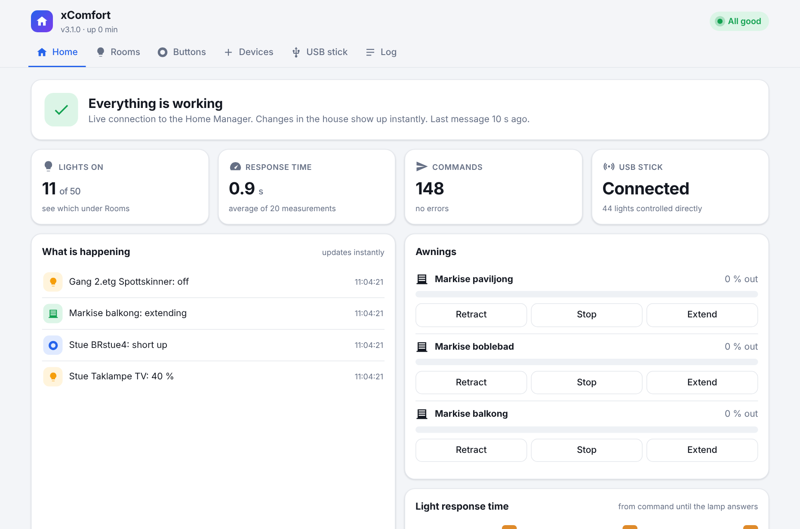
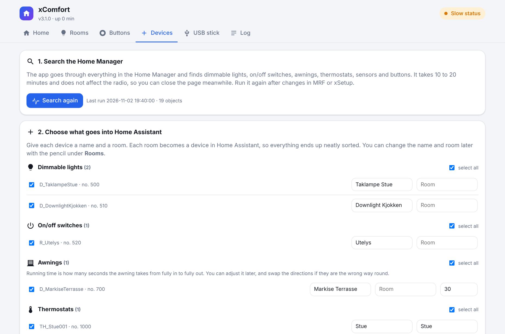
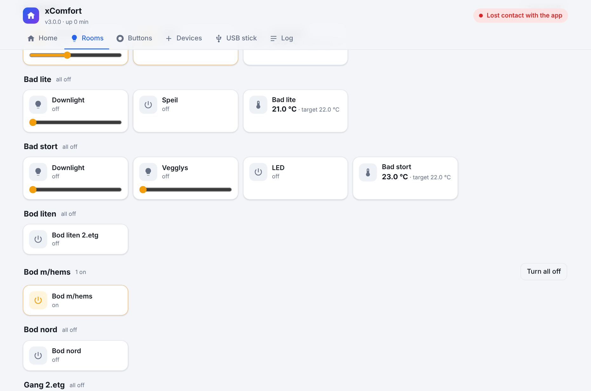
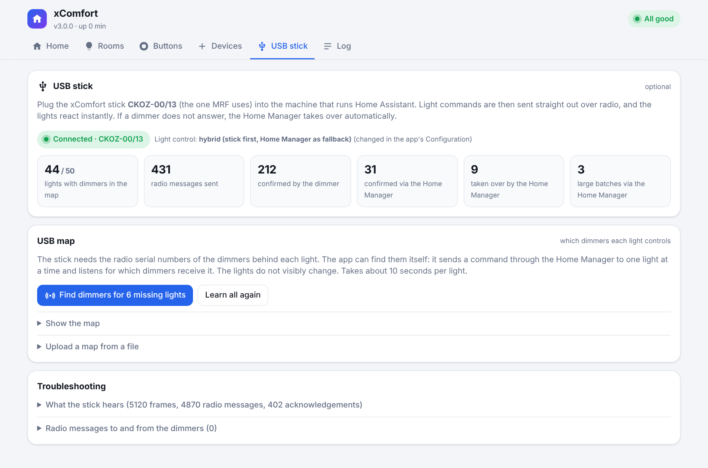
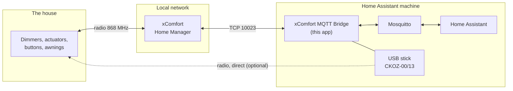

<p align="center">
  
</p>

<h3 align="center">Eaton / Sensio xComfort in Home Assistant. Fully local.</h3>

<p align="center">
  No cloud. No app. No waiting.<br>
  Lights, switches, awnings, thermostats, sensors and wall buttons straight into Home Assistant,<br>
  with an optional USB stick that controls the lights directly over radio.
</p>

<p align="center">
  <b>🇬🇧 English</b> · <a href="README.no.md">🇳🇴 Norsk</a>
</p>

<p align="center">
  <a href="https://my.home-assistant.io/redirect/supervisor_add_addon_repository/?repository_url=https%3A%2F%2Fgithub.com%2FPolsaFH%2Fxcomfort-ha"></a>
</p>

<p align="center">
  
  
  
  
  
</p>

<p align="center">
  <picture>
    <source media="(prefers-color-scheme: dark)" srcset="images/home-dark.png">
    
  </picture>
</p>

> [!WARNING]
> **Early version.** The app was built for and tested thoroughly in one house with about 100 xComfort devices.
> It is now open to everyone. It does nothing to your installation until you choose what to add, but take a
> backup of Home Assistant first, and please report anything that does not work under
> [Issues](https://github.com/PolsaFH/xcomfort-ha/issues).

---

## Contents

- [Why](#why)
- [What you get](#what-you-get)
- [Up and running in 10 minutes](#up-and-running-in-10-minutes)
- [Docker (without Home Assistant OS)](#docker-without-home-assistant-os)
- [The web page](#the-web-page)
- [The USB stick: instant lights](#the-usb-stick-instant-lights)
- [Wall buttons in automations](#wall-buttons-in-automations)
- [Settings](#settings)
- [How it works](#how-it-works)
- [When you change something in xSetup or MRF](#when-you-change-something-in-xsetup-or-mrf)
- [Troubleshooting](#troubleshooting)
- [Limitations](#limitations)
- [Security](#security)
- [For developers](#for-developers)

---

## Why

xComfort is a solid, reliable radio system with its own app and cloud service. Many people also want it to work
together with the rest of their smart home, and many prefer to keep everything on the local network.

This app connects the **Home Manager** to Home Assistant over your local network, the same way the eoptHome app
talks to it. The result is that xComfort becomes a natural part of Home Assistant: in dashboards, automations,
voice control and Google Home or Apple Home. The eoptHome app and everything else you use today keep working as
before.

**Which controller?** The app is built for the **Sensio X1 / xComfort Home Manager** used with eoptHome and
xSetup (common in Norway). If you have Eaton's newer **xComfort Bridge** or the older **Smart Home Controller
(SHC)**, there are other integrations for those. Other Home Manager models may work too. Please tell us if you
try.

---

## What you get

| | |
|---|---|
| 💡 **Dimmable lights** | Dimmers become `light` entities. Changes from a wall switch show up in under a second. |
| 🔌 **On/off switches** | Patio heaters, fans, floodlights and other actuators become `switch` entities. |
| ☀️ **Awnings** | Extend, retract and stop, with the position estimated from the running time you set. |
| 🌡️ **Thermostats and sensors** | Room temperature and target temperature as `climate` entities. Temperature, light, wind and other values as sensors. Inputs such as door contacts can be on/off sensors. |
| 🔘 **Wall buttons as smart buttons** | Short press, long press and release become events. Use them for music, scenes or anything else. |
| 📡 **USB stick (optional)** | Lights are controlled directly over radio and react instantly. The Home Manager takes over if a dimmer does not answer. |
| 🧠 **Learns by itself** | Finds the devices in the Home Manager, and finds which dimmers each light controls. No numbers to type in. |
| 🔁 **Survives changes** | When an upload from xSetup gives objects new numbers, the app finds them again by name. Your automations keep working. |
| 🖥️ **Its own web page** | Status, rooms, buttons, log and tools, right in the Home Assistant sidebar. Dark mode and mobile friendly. |
| 📊 **Diagnostics** | Response time, radio traffic and errors as sensors, so you can be notified when something goes wrong. |
| 🔒 **100 % local** | No account, no cloud, no internet. Works when the internet is down. |

---

## Up and running in 10 minutes

### What you need

- **Home Assistant OS or Supervised.** That is where apps (add-ons) are available. Running Home Assistant in
  Docker? See [Docker](#docker-without-home-assistant-os).
- The **Mosquitto broker** app and the **MQTT** integration. Don't have them? *Settings → Apps → App store →
  Mosquitto broker → Install → Start*. Home Assistant then suggests the MQTT integration by itself.
- **A separate user for the app**, e.g. `xcomfort`: *Settings → People → Users → Add*. Mosquitto accepts Home
  Assistant users automatically.
- **The IP address of the Home Manager.** Give it a fixed address in your router (DHCP reservation), or the app
  loses contact the day the address changes.

You do **not** need the eoptHome app, an Eaton account or internet access.

### 1. Install

Press the button at the top, or do it by hand:

1. *Settings → Apps → App store → ⋮ → Repositories*
2. Paste `https://github.com/PolsaFH/xcomfort-ha` and press **Add**.
3. Find **xComfort MQTT Bridge** in the list and press **Install**.

### 2. Fill in three things

On the **Configuration** tab:

| Field | Example |
|---|---|
| Home Manager IP | `192.168.1.50` |
| MQTT username | `xcomfort` |
| MQTT password | the password of the user above |

Everything else can stay as it is.

### 3. Start

On the **Info** tab: turn on **Start on boot**, **Watchdog** and **Show in sidebar**, and press **Start**.

### 4. Find your devices

Open **xComfort** in the sidebar. The first time, a guide welcomes you:

<p align="center"></p>

1. Press **Start search**. The app goes through everything in the Home Manager (10 to 20 minutes, does not affect the radio).
2. Give each device a name and a room. Lights, switches, awnings, thermostats, sensors and buttons are listed
   separately. For awnings you also set the running time, and for sensors the unit.
3. Press **Add selected to Home Assistant**.

Done. The devices are now under *Settings → Devices & services → MQTT*, sorted by room, ready to use like
anything else in Home Assistant.

---

## Docker (without Home Assistant OS)

Running Home Assistant in Docker (Container)? Then apps are not available, but the bridge is an ordinary
container and runs fine on its own. You need an MQTT broker (for example Mosquitto in Docker) and the **MQTT**
integration in Home Assistant.

> Running it this way is new. Tell us in an issue if something does not work.

**1.** Create a folder, e.g. `xcomfort`, with a subfolder `data` and the file `data/options.json`:

```json
{
  "xcomfort_ip": "192.168.1.50",
  "mqtt_host": "192.168.1.10",
  "mqtt_port": 1883,
  "mqtt_username": "xcomfort",
  "mqtt_password": "your-mqtt-password",
  "light_control": "hybrid"
}
```

`xcomfort_ip` is the Home Manager / Sensio X1, and `mqtt_host` is the machine running the MQTT broker (not
`core-mosquitto`, that name only exists in Home Assistant OS). Everything else from [Settings](#settings) can
be added with the same names as in [config.yaml](xcomfort_bridge/config.yaml). What you leave out gets the
default value.

**2.** Create `docker-compose.yml` in the same folder:

```yaml
services:
  xcomfort:
    build: https://github.com/PolsaFH/xcomfort-ha.git#main:xcomfort_bridge
    container_name: xcomfort-bridge
    restart: unless-stopped
    ports:
      - "8099:8099"
    volumes:
      - ./data:/data
      - /etc/localtime:/etc/localtime:ro
    # Only if you have the USB stick (CKOZ-00/13):
    # devices:
    #   - /dev/bus/usb:/dev/bus/usb
```

**3.** Start it:

```bash
docker compose up -d --build
docker compose logs -f
```

Docker builds the image straight from this repository, so there is nothing to download first.

**4.** Open `http://<ip-of-the-docker-machine>:8099` and follow the guide under **Devices**, just like in
Home Assistant OS.

**Update** to a new version with `docker compose up -d --build` again. Your devices and settings are kept in
the `data` folder.

Good to know:

- **The web page has no login** when it runs outside Home Assistant. Anyone on your network can open it and
  control the lights. Don't make port 8099 reachable from the internet. To reach it only from the Docker
  machine itself, use `"127.0.0.1:8099:8099"`.
- **The USB stick** must be plugged in before the container starts. If you plug it in later, restart the
  container with `docker compose restart`.
- **Plain `docker run`** works too:
  `docker run -d --name xcomfort-bridge --restart unless-stopped -p 8099:8099 -v "$PWD/data:/data" xcomfort-bridge`
  after `docker build -t xcomfort-bridge https://github.com/PolsaFH/xcomfort-ha.git#main:xcomfort_bridge`.

---

## The web page

| Tab | What you find |
|---|---|
| **Home** | «Everything is working», or exactly what is wrong. Key numbers, awnings and a live list of everything happening in the house. |
| **Rooms** | All devices by room, with filters for lights, switches, awnings, heating and sensors. Click for on/off, drag to dim, «Turn all off» per room. The pencil changes name and room, and for awnings the running time and direction. |
| **Buttons** | All wall buttons with their last press. Press a new button in the house and it shows up here, ready to add with one click. |
| **Devices** | Search the Home Manager, add new devices, find objects and download a backup. |
| **USB stick** | Stick status, automatic learning of which dimmers each light controls, and troubleshooting. |
| **Log** | Colour coded log with filter, search, pause and download, plus raw traffic from the Home Manager. |

<p align="center"></p>

---

## The USB stick: instant lights

The Home Manager forwards light commands over radio, and many installations are set up with a dimming time of
several seconds. With the xComfort stick **CKOZ-00/13** (the same USB stick MRF uses) in the machine that runs
Home Assistant, the app sends commands **straight to the dimmer**. The light reacts instantly.

<p align="center"></p>

1. Plug the stick into the Home Assistant machine, preferably in the middle of the house. It can be plugged in
   and out while the app is running.
2. Open **USB stick** on the web page and press **Find dimmers**. The app sends a command through the Home
   Manager to one light at a time and listens for which dimmers receive it. The lights do not visibly change.
3. Done. Lights with dimmers in the map are now controlled directly.

**Safe by default.** The **Light control** setting decides what is used:

| Value | Meaning |
|---|---|
| `hybrid` (default) | The stick first. Each dimmer gets 0.35 seconds to answer, and one more try. If neither the stick nor the Home Manager has seen the light change after 3 seconds, the Home Manager sends the command. Batches to more than 6 dimmers (e.g. all outdoor lights) go straight through the Home Manager, because it is faster. Without a stick everything works as before. |
| `usb_stick` | The stick only, no fallback. |
| `home_manager` | The Home Manager only. The stick is not used. |

Switches, thermostats and awnings always go through the Home Manager.

> The stick can only be used by one program at a time. To use MRF, move the stick to your PC and put it back
> afterwards. The app uses the Home Manager while the stick is away, and finds it again by itself.

<details>
<summary>Build the map yourself from MRF (for the curious)</summary>

If you have the MRF export and an xSetup backup, the map can also be built with
[`tools/make_usb_map.py`](tools/make_usb_map.py) and uploaded under *USB stick → Upload a map from a file*.
The format is `{"lys": {"<smuxId>": [serial, ...]}}`.
</details>

---

## Wall buttons in automations

An xComfort button can control things other than lights: music, scenes, the garage door, anything.

**1. Make the button visible to the Home Manager.** In MRF: link the button to the Home Manager and transfer. In
xSetup: set the datapoint to **General input** and upload.

**2. Add it.** Press the button in the house. It shows up under **Buttons** on the web page. Press **Add to HA**.

**3. Create an automation.** The button is an `event` entity with these event types:

| `event_type` | Meaning |
|---|---|
| `short_up` / `short_down` | Short press on the upper / lower part |
| `long_up` / `long_down` | Holding the upper / lower part |
| `long_up_release` / `long_down_release` | Released after a long press |

```yaml
alias: Living room button 4 - movie mode
triggers:
  - trigger: event.received
    target:
      entity_id: event.stue_brstue4
    options:
      event_type: [short_up]
actions:
  - action: scene.turn_on
    target:
      entity_id: scene.movie
mode: single
```

**Tips:**
- **Double press:** wait 0.8 seconds with `wait_for_trigger` after the first press and see if another one comes.
- **Volume or dimming while holding:** start a loop on `long_up` and stop it on `long_up_release` (`mode: restart`).
- The button still does what it is programmed to do in xComfort as well. To use it only in Home Assistant,
  don't link it to any actuator in MRF.

---

## Settings

| Setting | Default | What it does |
|---|---|---|
| Home Manager IP | | Local IP of the Home Manager. Required. |
| Home Manager port | `10023` | Almost never changed. |
| MQTT broker / port | `core-mosquitto` / `1883` | Correct if you use the Mosquitto app. |
| MQTT username / password | | The user the app logs in with. Stored in the app settings only. |
| Light control | `hybrid` | `hybrid`, `usb_stick` or `home_manager`, see [the USB stick](#the-usb-stick-instant-lights). |
| Instant status | on | Keeps a connection open and receives changes in under a second. Required for buttons. |
| Poll interval | `20` s | How often everything is read when instant status is off. |
| Log level | `info` | `debug` logs all traffic to and from the Home Manager. |
| Awning settings | | Position, pauses and double stop for all awnings. Awnings you add get their running time on the web page. |

The setting descriptions are shown in Norwegian when Home Assistant is set to Norwegian.

---

## How it works



- The app keeps one connection open to the Home Manager, which reports every change right away.
- Commands from Home Assistant go straight to the Home Manager, or straight to the dimmer through the USB stick.
- Everything shows up through **MQTT discovery**. No `configuration.yaml`.
- Each entity has a fixed `unique_id`, so you can rename it, move it to another area and give it an icon
  without breaking anything.

---

## When you change something in xSetup or MRF

Every upload from xSetup can give objects in the Home Manager **new internal numbers**, especially buttons and
inputs. The app takes care of it:

- At startup, every 6 hours and after each search it checks that everything still has the right number.
- If something got a new number, it finds it again by name. The log says «followed automatically».
- `entity_id` and `unique_id` in Home Assistant do **not** change.

Feel free to run **Devices → Search again** afterwards, and download a new backup.

> **Trap:** MRF can show a datapoint as free even though xSetup still uses it. Always check in xSetup before you
> choose a datapoint in MRF.

---

## Troubleshooting

| Problem | Try this |
|---|---|
| No devices in Home Assistant | Is the MQTT integration added, and are the username and password correct? See the **Log** tab. Have you added devices under **Devices**? |
| No contact with the Home Manager | Check the IP address. Did the Home Manager get a new address? |
| The search finds no lights | Lights must exist in xSetup (the object `D_<name>`). Use **Devices → Find an object** to see what the Home Manager actually has. |
| Lights react slowly | See the response time on **Home**. Long times usually mean poor radio coverage or a long dimming time in MRF. The USB stick helps. |
| The USB stick is not found | Check that it is plugged into the Home Assistant machine and that MRF is not using it. The app looks for it every 10 seconds. |
| «No answer» from some lights while learning | They are probably out of range of the stick. They are still controlled through the Home Manager. Move the stick closer and try again. |
| An awning goes the wrong way, or the position is off | Press the pencil on the awning under **Rooms**. Tick **Swap directions**, or adjust the running time (seconds from fully in to fully out). |
| A sensor has the wrong unit | Press the pencil on the sensor under **Rooms** and choose the right unit. |
| A button sends nothing | Is it a **General input** in xSetup, and uploaded? Does it show up under **Buttons** when you press it? |
| Need more details | Set **Log level** to `debug`, repeat the problem, download the log from the web page and attach it to an issue. |

---

## Limitations

To be honest, this is what remains:

- **Awning position is estimated** from the running time, since the awnings do not report where they are.
  Run each awning fully in once after adding it, so the app knows where it starts.
- **Light scenes** stored in the Home Manager are not available yet. Wall buttons and Home Assistant scenes work
  fine in the meantime.
- **The search recognises devices by the names xSetup gives them** (`D_`, `R_`, `TH_`, `TS_`, `IN_` and so on).
  Something missing? Find it under **Devices → Find an object** (inputs can be added there directly), or open
  an issue with the names you see there.
- **Tested on one installation** (Sensio X1 / Home Manager with an extra controller). Other setups should work,
  but are not confirmed yet.
- **The USB stick** is tested with the CKOZ-00/13, and uses the same commands MRF uses when you test a light.
- This app is not made or supported by Eaton.

---

## Security

- The Home Manager is designed to sit on a private home network, and this app talks to it on that network only.
  Keep it that way: don't make the Home Manager reachable from the internet, for example through port forwarding
  in your router.
- Use a separate MQTT user for the app, and keep Home Assistant up to date.
- The app does nothing to your installation until you have chosen devices. It recognises the installation it
  was built on by checking the names in the Home Manager, and otherwise only uses what you add yourself.
- **Keep your project files private.** MRF exports and xSetup backups describe your whole installation. Don't
  share them or upload them anywhere public. `.gitignore` in this repository stops the most common ones.

---

## For developers

```
xcomfort-ha/
├── repository.yaml                  App repository for Home Assistant
├── tools/make_usb_map.py            Builds a USB map from an MRF export + xSetup backup (optional)
└── xcomfort_bridge/
    ├── config.yaml                  Version, settings, web page (ingress), USB
    ├── xcomfort_mqtt_bridge.py      Main program: MQTT, discovery, commands, USB control
    ├── xcomfort_local_control.py    The Home Manager protocol (+ the device list for the author's house)
    ├── hm_link.py                   The listener connection (instant status and the fast command path)
    ├── usbstick.py                  Direct radio through the CKOZ-00/13 USB stick
    ├── scanner.py                   Searches all objects in the Home Manager
    ├── idmap.py                     Follows objects that get a new number
    ├── web.py, web/index.html       The web page in the sidebar
    ├── translations/                Setting texts (English and Norwegian)
    ├── tests/test_bro.py            Tests against a fake Home Manager and a fake USB stick
    └── CHANGELOG.md
```

Code comments are mostly in Norwegian.

### The Home Manager protocol

Plain text over TCP port 10023. Every message is wrapped in `0x01` … `0x02`.

| Direction | Message | Meaning |
|---|---|---|
| → | `d_obj <id>` | Subscribe to an object. The Home Manager answers with its value and sends later changes. |
| ← | `SSN <id> <name> <type> … <value>` | Value or change |
| → | `set_value <id> <value>` | Set a value, e.g. brightness 0 to 100 |
| → | `new_state <id> 0` | Execute |

The Home Manager sends changes to **all** open connections.

### The USB stick

The app uses the stick the same way MRF does when you test a light: it sends on, off and set level commands to a
dimmer and waits for the dimmer's acknowledgement. Only dimmers that are part of your own installation and listed
in the USB map are ever addressed. See [`usbstick.py`](xcomfort_bridge/usbstick.py).

### Which installation?

At first start the app asks the Home Manager for the names of some known objects. If they match the author's
installation, the built-in device list is used. Otherwise the app starts empty. The choice is saved in
`/data/anlegg.json` (`{"innebygd": false}`) and can be overridden there.

### Tests

```bash
cd xcomfort_bridge
pip install paho-mqtt pyusb
python -m unittest discover -s tests -v
```

The tests run automatically on GitHub on every push. They do not need a real installation.

---

<p align="center">
  Made in Norway for a house with too many light switches. 💡<br>
  <a href="LICENSE">MIT License</a> · <sub>Eaton, xComfort and Sensio are trademarks of their respective owners. This project is independent.</sub>
</p>
